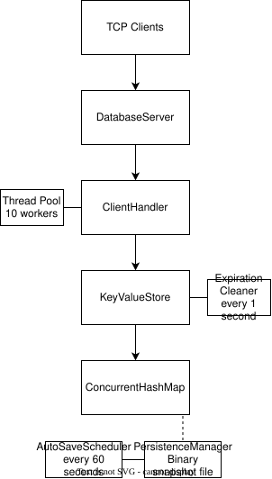
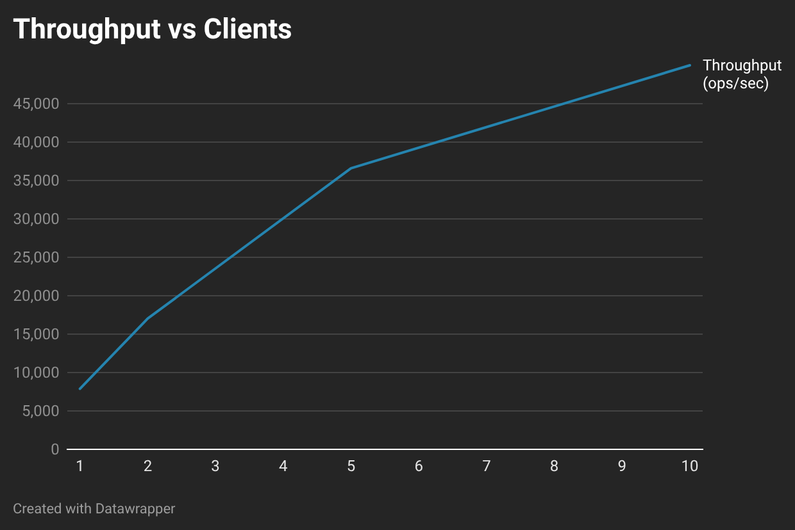
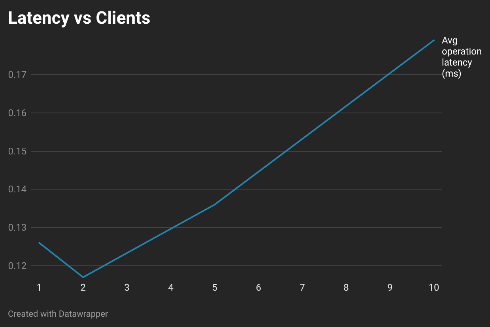

# key-value-store
## 1. Overview
Key-value-store is a Redis-inspired, in-memory Java database that communicates over TCP. It allows users to concurrently access or modify key-value pairs stored in the database.

It supports up to 10 active concurrent users, uses atomic operations, and supports automatic saving, key expirations, as well as a graceful shutdown implementation.
## 2. Features
- TCP server: supports multiple simultaneous client connections using a fixed thread pool and a bounded task queue
- Key-value operations: supports SET, GET, DEL, EXPIRE, and INCR commands
- Thread-safe storage: uses ConcurrentHashMap with atomic operations for concurrent access
- Key expiration: combines lazy expiration with periodic background cleanup
- Persistence: saves and restores data using a custom binary snapshot format, with automatic and manual saving
- Graceful shutdown: attempts to complete active requests and save the database before closing 
- Docker support: can be built and run in a Docker container.

## 3. Quick start
A docker file has been provided in the project’s root folder, to make the program’s setup simpler.

### Step 1. 
1. Clone the repository and navigate to the project directory:
```
git clone https://github.com/jakovhorv/key-value-store.git
```
```
cd key-value-store
```

2. Build the Docker image:
```
docker build -t key-value-store .
```

3. Start the database server:
```
docker run -p 6379:6379 key-value-store
```
### Step 2.
Open a second terminal and connect using Netcat:
```
nc localhost 6379
```

You can now execute commands:
```
SET name Alice
OK
GET name
Alice
INCR counter
1
EXPIRE name 60
1
GET missing
NULL
SAVE
OK
```

### Running Without Docker
Requires Java 21 or later.

1. Compile the source files:
```
javac -d out $(find src -name "*.java")
```

2. Start the server:
```
java -cp out database.DatabaseServer
```

3. Connect using Netcat as shown above.

## 4. Supported commands
Note: Commands (SET, GET...) are **not** case-sensitive.

### SET
- sets a key’s value, overriding the previous one.
- creates a key with a value pair.

#### Syntax: SET key value
#### Complexity: O(1)

### GET
- returns a key’s value, if a key does not exist it returns “NULL”.

#### Syntax: GET key
#### Complexity: O(1)

### DEL
- deletes a key from the database. If a delete was successful, it returns “1”. If not, it returns “0”.

#### Syntax: DEL key
#### Complexity: O(1)

### EXPIRE
- sets a key’s expiration in seconds. If the set expiration is 0, it will immediately expire the key. Returns “1” if the key exists, and “0” if it does not.

#### Syntax: EXPIRE key duration
#### Complexity: O(1)

### SAVE
- saves the database into a file.

#### Syntax: SAVE
#### Complexity: O(n + B)
Where:
- n is the number of entries.
- B is the total serialized size.

### INCR
- increments a key’s value by one, creating a key with a value of 1 if it does not exist. Returns the new incremented value, or an error if the key’s value is not a number.

#### Syntax: INCR key
#### Complexity: O(1)

## 5. Architecture
<p align="center">
  
</p>

### Components
- DatabaseServer - accepts TCP connections and dispatches clients to a fixed thread pool
- ClientHandler - parses commands, invokes database operations, and sends responses
- KeyValueStore - manages entries using ConcurrentHashMap and atomic per-key operations
- ExpirationCleaner - periodically removes expired keys
- AutoSaveScheduler - periodically triggers saving
- PersistenceManager - saves and loads the database

### Architectural decisions
#### Concurrency
A fixed thread pool of 10 workers was created to limit resource consumption.

A ConcurrentHashMap was used to allow multiple client threads to safely access and modify the shared key-value store concurrently.

For operations such as INCR, compute() ensured atomic read-modify-write operations, preventing lost updates if multiple clients attempted to modify the same key concurrently.

#### Expiration
On top of creating a background cleanup, implementing lazy expiration made memory consumption more efficient, since expired keys would not have to wait for ExpirationCleaner.

#### Persistence
Snapshot-based persistence ensured a simple way of saving and loading data. The data itself is a custom binary format containing:
1. A magic number, for format identification
2. A version number,
3. The number of entries
4. Each entry's values

Making the database first save into a temporary file, before atomically moving its contents into the primary one prevents a failed save from corrupting or partially overwriting the existing save. Though, since persistence is not continuous, data can still be lost if the server crashes before it saved.

## 6. Tests
The tests were written using JUnit 5.

Concurrency tests verify that multiple threads can modify shared data without losing updates. In particular, concurrent INCR operations are tested to ensure that increments to the same key are atomic.

Integration tests communicate with the server over TCP to verify that requests are correctly processed and responses are returned as expected.
### Classes
- KeyValueStoreTest - Key-value operations, TTL behavior, integer overflow, and concurrent updates
- PersistenceManagerTest - Saving and loading snapshots, file validation, and expiration timestamps
- ExpirationCleanerTest - Periodic removal of expired entries
- AutoSaveSchedulerTest - Automatic saving at configured intervals
- DatabaseServerIntegrationTest - Client-server communication, command responses, and server shutdown

## 7. Benchmarks
The benchmarks were run on a computer with the following specifications:
- CPU: AMD Ryzen 5 2600 3400 Mhz, 6 Core(s), 12 Logical Processor(s)
- RAM: 16 GB DDR4-3000 (3000 MT/s)
- OS: Windows 11

The benchmarks measured:
1. Throughput,
2. Average round-trip latency of each client’s operation

### Results


Throughput increased with concurrent clients. Scaling was sublinear overall.



Latency increased with concurrent clients.

### Limitations
- The benchmarks were run without a warm-up period, possibly influencing throughput and latency measurements.
- Round-trip latency includes TCP communication, Java I/O, and client processing
- Only SET commands were tested
- The benchmarks were run on localhost, so network latency is significantly lower than it would typically be when communicating with a remote server.

These benchmarks provide a basic evaluation of the database’s performance. More sophisticated benchmarks were outside the scope of this project.
## 8. Limitations
- Limited command support
- Potential data loss - server can crash before snapshots are saved
- Non-atomic snapshots - ConcurrentHashMap allows modifications while a snapshot is being created
- In-memory storage - the database stores its active data in RAM
- Docker data is stored inside the container
